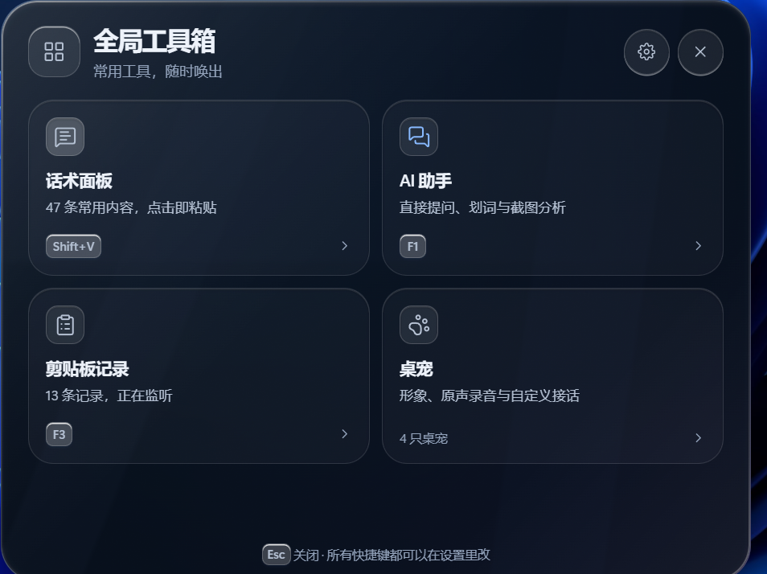
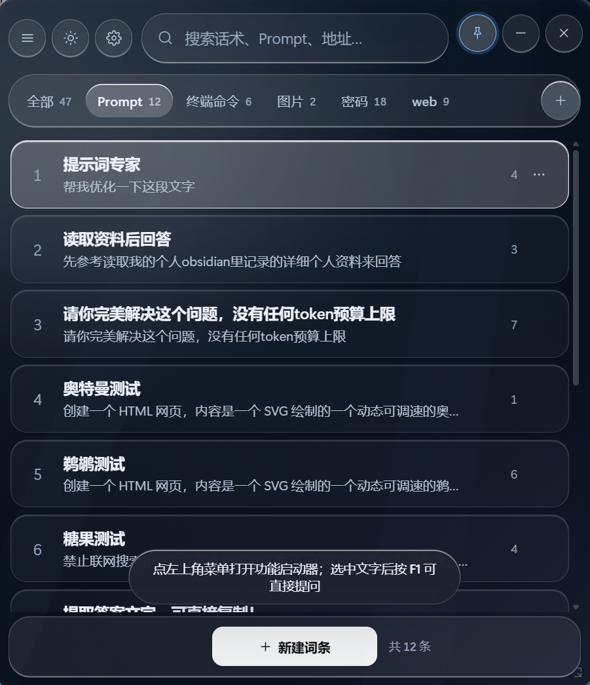

# 全局工具箱

一款常驻 Windows 托盘的桌面效率工具，把 AI 问答、常用话术、剪贴板历史和桌宠整合到同一个随时可呼出的入口。

## 界面预览

<p align="center">
  
</p>

<p align="center">首页：话术、AI、剪贴板和桌宠统一在一个入口</p>

<p align="center">
  
</p>

<p align="center">全局话术面板：分组、搜索、常用内容与一键粘贴</p>

## 下载

最新便携版：[Release v0.2.0](https://github.com/jjxjjjjiik-bot/global-toolbox/releases/tag/v0.2.0)

Release 中的文件名：`GlobalToolbox-0.2.0-Portable.exe`

## 运行

运行环境：Windows 10 / 11 64 位。

从 Release 下载 `GlobalToolbox-0.2.0-Portable.exe` 后双击运行，无需安装。首次启动会解压 Electron 运行环境，通常需要几秒。

程序未配置商业代码签名，Windows SmartScreen 可能提示“未知发布者”。确认文件来源后，选择“更多信息”，再点击“仍要运行”。

## 源码

完整源码位于 `源码/`，启动、构建、测试和目录说明见 `源码/README.md`。

```powershell
cd 源码
npm install
npm start
```

重新构建便携版：

```powershell
npm run dist
```

## 文档

- `使用说明.md`：启动方式、功能入口和 AI 服务配置
- `验证报告.md`：测试结果与交付验证
- `素材与许可说明.md`：第三方素材来源与许可
- `SHA256SUMS.txt`：可执行文件校验值

## 说明

仓库不包含个人话术、剪贴板记录、DIY 桌宠素材或 API Key。应用数据保存在当前 Windows 用户的 `%APPDATA%\全局工具箱`。
